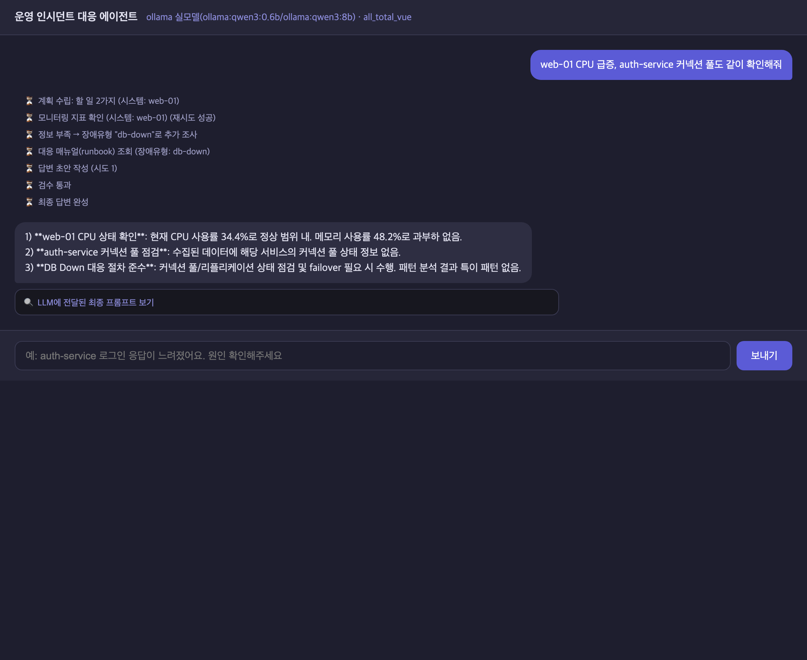
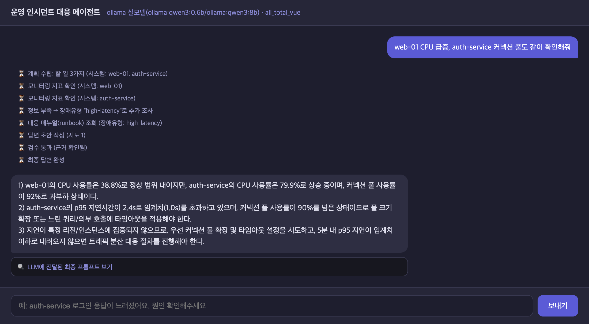
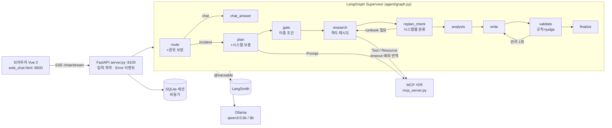

# 운영 장애 대응 Multi-Agent — 측정으로 찾고, 근거로 고친 개선 기록

장애 질문("web-01 CPU 급증, auth-service 커넥션 풀도 확인해줘")을 받으면, 에이전트가 다음 순서로 대응 절차를 답한다.

1. 질문 분류
2. 조사 계획
3. MCP로 모니터링 조회
4. 장애 유형 판단 → runbook 검색
5. 답변 작성
6. 검증

**LangGraph Supervisor + MCP + FastAPI(SSE) + Vue 3 + LangSmith**로 만든 실습 프로젝트(`all_total_vue`)다. 이 저장소는 그 위에서 진행한 **Before 측정 → 문제 정의 → 단계별 수정 → After 측정** 과정을 담고 있다.

> 응답 성공률은 **97%**였다. 그런데 정답 세트로 다시 재니 **4번 중 1번은 틀린 매뉴얼**(정답률 0.739)을 주고 있었고, 응답 하나가 서버를 **300초** 멈추기도 했다.
> → 측정 방법부터 바꾸고, 원인을 증거로 확인한 순서대로 고쳤다.

## 결과 한눈에 보기

같은 질문 10개를 3회씩, 같은 모델(qwen3:0.6b / qwen3:8b, Ollama)로 측정했다.

| 지표 | Before | After |
|---|---|---|
| **검색 정확도** (runbook 정답률) | 0.739 | **1.0** |
| 조사 범위 recall | 0.775 | **1.0** |
| LLM-judge 답변 품질 | 0.855 | **0.955** |
| **장애 질문 응답시간** (중앙값) | 36.0초 | **12.8초** (−64%) |
| 최대 응답시간 | 300초 (타임아웃) | **24.4초** |
| 응답 대기 중 다른 요청(`/health`) 지연 | 최대 1.73초 | **0.03초** |
| **비용** (가상 단가 × 실측 토큰) | $0.1637 | **$0.1360** (−17%) |
| 응답 성공률 (기존 지표) | 0.97 | 1.0 |
| 단위 테스트 | 15 passed + 1 xfail | **70 passed** |

- 출처: `bench/results/baseline_*`(Before), `after_*`(After, 발표 기준). 최신 코드로 다시 잰 `after_n_*`도 같은 수준이다(아래 '측정 이력'). 비교표 전체와 다시 계산하는 명령은 [`outputs/after/README.md`](outputs/after/README.md)에 있다.
- 나빠진 점도 같은 문서에 기록했다: q04 judge 0.95 → 0.75, q02는 검증 재작성으로 22.9초.

| Before | After |
|---|---|
|  |  |
| web-01만 조사, **db-down** 매뉴얼(오분류) | 두 시스템 조사, **high-latency**, "검수 통과 (근거 확인됨)" |

## 측정 이력 — 어느 결과가 최신인가

| 순서 | 결과 파일 (`bench/results/`) | 측정 시각 | 코드 | 상태 |
|---|---|---|---|---|
| 1 | `baseline_*` | 10-20 14:14 | tag `baseline` (원본) | **Before 기준** |
| 2 | `baseline_rerun1021_*` | 10-21 16:11 | 원본 | 참고용 재실행. 같은 코드도 회차마다 흔들린다는 근거(이번 회차는 q01 타임아웃 없음) |
| 3 | `after_run1_*` | 10-21 21:25 | `1f8e51d` (1~7단계) | **폐기**: q10 라우팅 회귀 발견 → `09b` 문서 |
| 4 | `after_*` + `after_langsmith_eval.json` | 10-21 21:33 | `83125f4` (+route 보정) | **발표 기준 After**. 화면 캡처·LangSmith judge가 이 회차다 |
| 5 | `after_n_*` | 10-21 22:20 | N1~N6 수정 후 (`11` 문서) | **최신 코드 회귀 확인**. 4번과 같은 수준인지 확인했다 (judge는 다시 돌리지 않음) |

| 지표 | Before (`baseline`) | After (`after`, 발표 기준) | 최신 (`after_n`) |
|---|---|---|---|
| runbook 정답률 / recall / precision | 0.739 / 0.775 / 0.87 | 1.0 / 1.0 / 1.0 | 1.0 / 1.0 / 1.0 |
| incident 중앙값 | 36.0초 | 12.8초 | 12.5초 |
| 최대 응답 | 300초 | 24.4초 | 24.7초 |
| chat 중앙값 | 1.28초 | 0.26초 | 0.26초 |
| 가상 비용 | $0.1637 | $0.1360 | $0.1368 |
| validate 재작성 | 0 | 3 (q02) | 3 (q02) |

### OpenAI(과금) 환경에서도 Before/After (gpt-4o-mini / gpt-4o)

| 순서 | 결과 파일 | 상태 |
|---|---|---|
| 6 | `openai_before_*` | OpenAI Before (`before-evidence` 코드) |
| 7 | `openai_after_run1_*` | 폐기: judge 오반려 발견 → N9 |
| 8 | `openai_after_*` | **OpenAI 최신 After** |

| 지표 | OpenAI Before | OpenAI After |
|---|---|---|
| runbook 정답률 | 0.75 | **1.0** |
| precision | 0.861 | **1.0** |
| LLM-judge | 0.835 | **0.96** |
| 장애 질문 응답 중앙값 | **5.3초** | 6.5초 (+1.2초) |
| 가상 비용 | **$0.074** | $0.147 (약 2배) |

같은 개선도 모델에 따라 효과가 다르다.
- 작은 로컬 모델에서는 정확도와 속도가 모두 올랐다.
- OpenAI에서는 정확도는 올랐지만, gpt-4o judge 호출만큼 느려지고 비용이 늘었다.

자세한 내용은 [`outputs/openai/README.md`](outputs/openai/README.md)에 있다.

## 무엇을 고쳤나 (고친 순서)

| 단계 | 문제 | 원인 (증거로 확인) | 고친 방법 | 문서 |
|---|---|---|---|---|
| 1 | 시스템 2개를 물어도 1개만 조사 | 0.6b 모델이 target에 `"get_monitoring_status Tool for web-01"` 같은 문장을 넣는다. 코드는 이것을 첫 시스템으로 덮어썼다 | 질문에 나온 시스템을 **코드가 항상 보충**. 3개 파일의 중복 로직을 `agent/systems.py`로 통합 | [03](outputs/final-report/03_step1_P1.md) |
| 2 | 근거가 없으면 무조건 db-down | 모든 알림을 합쳐 규칙을 검사하고, 아무것도 안 걸리면 db-down | 이상이 있는 시스템을 언급 순서대로 본다. 근거가 없으면 runbook을 붙이지 않는다 | [04](outputs/final-report/04_step2_P2.md) |
| 3 | 300초 정지, 응답 편차, 불필요한 분석 | async 노드 안의 동기 `httpx.post`, timeout 300초 하나, qwen3 thinking 토큰(190 → 9개로 실측) | `AsyncClient`, 이중 게이트, 단계별 timeout, `think:false`, 노드별 `elapsed_ms` | [05](outputs/final-report/05_step3_P3_P4_P9.md) |
| 4 | 재시도가 안 되고, 실패는 조용함 | SDK 타임아웃(`MCPError`)은 재시도 대상이 아님, gather에 격리 없음 | MCP 예외를 재시도 가능 여부로 번역, task별 격리, SSE `Error` 이벤트 + 빨간 말풍선 | [06](outputs/final-report/06_step4_P5_P6.md) |
| 5 | 빈 입력 200, 이력 유실 | 요청 모델에 계약이 없음 | Pydantic 계약 → 422, SSE 헤더, 질문 선저장 | [07](outputs/final-report/07_step5_P7.md) |
| 6 | 검증이 형식만 봄 | `len >= 30 and "1)" in draft` | 규칙 3개 + LLM judge(0.6b와 8b를 비교 실험한 뒤 8b 채택), 재작성 1회 | [08](outputs/final-report/08_step6_P11.md) |
| 7 | 동기 세션 저장, v1 롤백이 동작하지 않음 | 동기 sqlite, fake 응답 문구에 의존 | `to_thread` 비동기 저장소 + 팩토리, v1도 질문으로 장애 판단 | [09](outputs/final-report/09_step7_E15_P10.md) |
| 8 | **After 측정이 찾은 회귀** | think를 끈 라우터가 자기소개를 장애로 분류(q10 14초) | route 권위 보정 → 재측정 | [09b](outputs/final-report/09b_step8_route_regression.md) |
| 9 | **실사용·탐색 스윕이 찾은 문제 N1~N6** | 장애 후 잡담에 보고서를 베낌, "결제 서버"·"WEB-01" 미인식, route 보정 부작용, 상태 질문에 지어낸 답, 질문에 없는 시스템 조사 | 이력 필터, 별칭·대소문자, 양방향 route 보정, 질문 시스템만 조사 | [11](outputs/final-report/11_new_issues_N1_N8.md) |
| 10 | **OpenAI 측정이 찾은 문제 N9** | judge가 runbook 제목만 봐서 runbook에 있는 조치를 '근거 없음'으로 오반려(gpt-4o, 4건) | runbook 본문을 judge에 전달 | [openai](outputs/openai/README.md) |

각 단계는 **커밋 1개 + 문서 1개**다. 문서는 7단계 문제 해결 형식(정의 → 원인 → 대안 비교 → 실행 → 검증 → 재발 방지)으로 썼고, 끝에 "직접 확인하는 방법"이 있다.

코드에서 `[P1 BEFORE]`(주석으로 남긴 원래 코드)나 `[P1 AFTER]`(고친 코드)로 검색하면 바뀐 곳이 모두 나온다. 현재 위치 목록은 [`00_code_index.md`](outputs/final-report/00_code_index.md)에 있다.

```bash
grep -n "\[P2 BEFORE\]\|\[P2 AFTER\]" agent/*.py
git diff before-evidence -- agent/graph.py      # Before 태그와 비교
```

## 아키텍처



| 기술 | 위치 |
|---|---|
| Multi-Agent | `agent/graph.py` `build_graph` (노드 10개, `_timed`로 노드별 시간 기록) |
| MCP | `mcp_server.py` (Tool·Resource·Prompt), `agent/mcp_client.py` `_call` |
| RAG | 장애 유형 분류 → `runbook://incident-response/{type}` Resource → write 프롬프트 |
| DI | `agent/deps.py` `SupervisorDeps`, `agent/session_store.py` `create_session_store` |
| LangSmith | 노드·LLM·MCP `@traceable`, `bench/eval_langsmith.py`(`evaluate` + LLM-judge) |
| 모듈화 | `agent/systems.py`(시스템 추출), `agent/errors.py`(에러 분류) |
| 단위 테스트 | `tests/test_agent_units.py` (LLM·MCP·서버 없이 0.7초) |

## 실행

```bash
bash sh/setup_venv.sh            # 최초 1회: .venv + requirements
cp .env.example .env             # LangSmith 키 입력 (선택)
bash sh/setup_ollama.sh          # 최초 1회: qwen3:0.6b / qwen3:8b

ollama serve                     # 터미널 1
bash sh/run_agent_ollma.sh       # 터미널 2 — 백엔드 :8100 (session.db를 초기화한다)
bash sh/run_frontend.sh          # 터미널 3 — 채팅 화면 http://localhost:8600
```

화면에서 해 볼 질문:

| 질문 | 보이는 것 |
|---|---|
| `web-01 CPU 급증, auth-service 커넥션 풀도 같이 확인해줘` | 두 시스템 조사, high-latency, 검수 통과 |
| `billing-service 응답이 느려요` | "모니터링 대상이 아닙니다" (엉뚱한 시스템을 조사하지 않음) |
| `제 이름은 민수입니다` → `제 이름이 뭐였죠?` | 바로 chat으로 답하고, 이름을 기억한다 |

## 테스트와 측정

```bash
./.venv/bin/python3 -m pytest tests -q                              # 70 passed
./.venv/bin/python3 bench/run_baseline.py --repeat 3 --tag after     # 성능 측정 (서버 필요, 약 6분)
./.venv/bin/python3 bench/rescore.py --tag after                     # 정답 세트 재채점 (서버 불필요)
set -a; source .env; set +a
cd bench && ../.venv/bin/python3 eval_langsmith.py --prefix after    # LangSmith evaluate + judge
```

- 정답 세트: `bench/eval_set.json` (질문별 기대 시스템, 장애 유형, 근거)
- 97%와 74%가 어느 코드에서 계산되는지는 [`02_measurement_trace.md`](outputs/final-report/02_measurement_trace.md)에 있다.

## 폴더 안내

| 경로 | 내용 |
|---|---|
| `agent/`, `server.py`, `mcp_server.py`, `web_chat.html` | 에이전트 코드 (`[Px BEFORE]` / `[Px AFTER]` 주석) |
| `tests/` | 단위 테스트 |
| `bench/` | 측정 스크립트, 정답 세트, 결과(`results/baseline_*`, `after_*`) |
| `outputs/before/` | Before 증거: 화면, 터미널, 코드 캡처, 원본 텍스트 |
| `outputs/after/` | After 증거(같은 파일명) + **Before/After 비교표** |
| `outputs/final-report/` | 문제 인식(01), 측정 추적(02), 단계별 기록(03~09b), **최종 발표(10)**, 새로 발견된 문제(11) |
| `doc/workLog.md` | 날짜별 작업 기록 |
| `doc/guide.md` | Before/After 측정과 캡처를 직접 재현하는 명령 |
| `doc/README.md` | 원래 실습 프로젝트 설명 (Wave 1~15) |

git 태그:
- `baseline`: 원본 실습 코드
- `before-evidence`: Before 측정을 고정한 시점

## 한계

- 평가 표본이 질문 10개 × 3회라 작다. 정답 세트에 맞춘 개선이라 **과적합 위험**이 있다.
- 시스템 추출, 장애 키워드, route 보정이 모두 키워드 규칙이다. 이름 없는 표현("결제 서버가 안 돼요")은 놓친다.
- 8b judge가 요청마다 약 3초를 쓴다. 응답시간의 60~70%는 아직 8b 답변 생성이다.
- 장애 직후 후속 질문("그럼 뭐부터 해?")은 문맥을 잃는다(N8). 동시 요청은 Ollama가 순서대로 처리해 느리다(N7).
- 하지 않은 것: LangGraph 공식 checkpointer 전환, 스트림 POST 전환.
